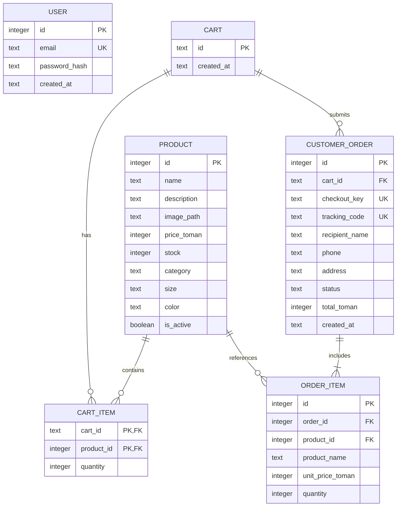

# نمودار رابطه‌ای پیشنهادی

این مدل در `app/models.py` پیاده‌سازی شده و با `flask --app app:create_app init-db` ساخته می‌شود. migration نسخه‌بندی‌شده هنوز وجود ندارد. قیود مبلغ کل نسبت به اقلام و داشتن حداقل یک قلم باید در سرویس checkout مرحله بعد اعمال شوند؛ مدل به تنهایی این قواعد بین چند ردیف را تضمین نمی‌کند.

## قیود
- کلید مرکب `CART_ITEM(cart_id, product_id)` مانع ردیف تکراری شود.
- قیمت و موجودی نامنفی؛ تعداد صحیح مثبت؛ مبلغ کل برابر مجموع تعداد × قیمت snapshot اقلام و در سرویس تراکنشی کنترل شود.
- حذف سبد اقلام آن را cascade کند؛ سبد دارای سفارش حذف نشود. محصول دارای سابقه حذف نشود و به جای آن غیرفعال شود.
- نام و قیمت اقلام سفارش پس از تغییر محصول ثابت بمانند.
- `checkout_key` و `tracking_code` یکتا و غیرقابل حدس؛ زمان ISO 8601 در UTC.
- اطلاعات گیرنده در سفارش است؛ حساب کاربر در مرحله ۳ اضافه شده است ولی هنوز به سبد و سفارش متصل نیست. وضعیت اولیه `placed` فقط ثبت سفارش است، نه پرداخت بانکی.

مرحله ۳: جدول `user` با ایمیل یکتا و هش رمز و ستون‌های دسته، سایز و رنگ محصول با مقدار پیش‌فرض خالی اضافه شدند. دستور `upgrade-db` داده مرحله ۲ را حفظ می‌کند.
